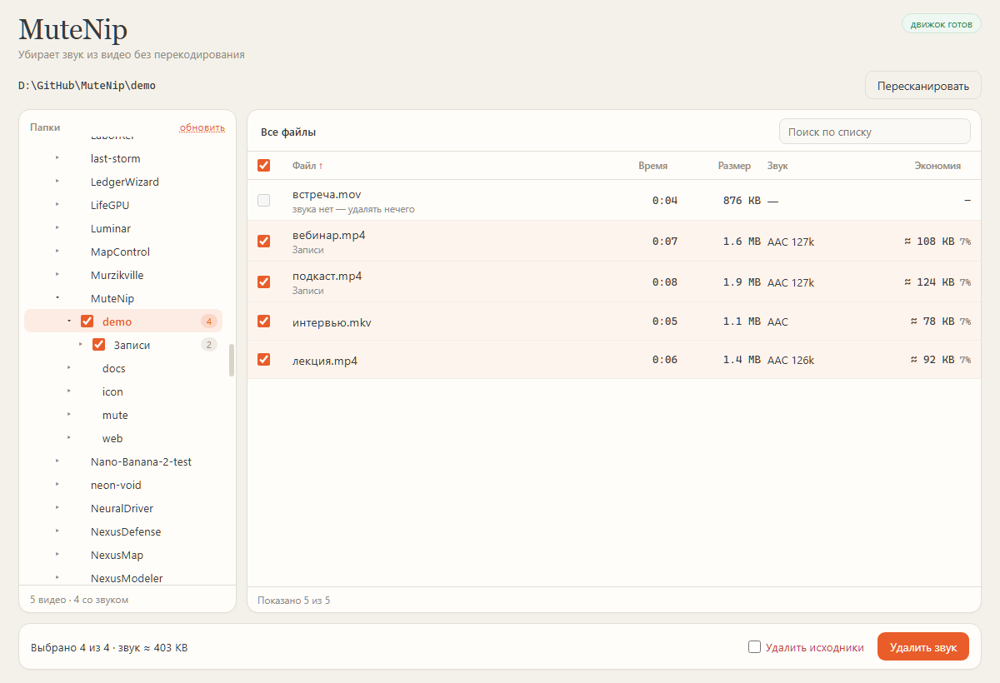

# MuteNip

Утилита для Windows, которая удаляет звуковую дорожку из локальных видео без перекодирования. Видео копируется бит-в-бит, файл уменьшается на размер аудио, качество картинки не меняется.

Выбор папки — постоянная панель навигации по дискам, без модальных диалогов. Внутри выбранной папки — список видео, примерная экономия по каждому файлу, выбор файлов и папок, пакетная обработка с прогрессом и отменой.

<p align="center"></p>



## Возможности

- Рекурсивный скан папки: видео ищутся и в подпапках.
- Постоянная навигация: диски и папки раскрываются лениво, выбранный корень подсвечивается.
- Выбор: отдельные файлы, папки целиком (tri-state), диапазон shift-кликом, «выбрать всё» в текущем списке.
- Поиск по списку; сортировка по имени, длительности, размеру и экономии.
- Оценка экономии по каждому файлу; фактическая разница показывается в итогах.
- Два режима: копия `name_na.ext` рядом с исходником или замена с удалением исходника.
- Прогресс по пачке и внутри файла, отмена с убийством дерева процессов.
- Итог: обработано, ошибки, предупреждения, фактически сэкономленное место.
- Один экземпляр, запоминание последней папки, лог в `%LOCALAPPDATA%\MuteNip\`.

## Требования

- Windows 10/11, x64.
- Microsoft Edge WebView2 Runtime — обычно уже установлен вместе с Windows.
- `ffmpeg.exe` и `ffprobe.exe`. В exe они не вшиты: бинарники ищутся рядом с `mutenip.exe`, в `PATH` и в `%LOCALAPPDATA%\clipnip\bin` (кэш ClipNip).

Утилита работает только с локальными файлами и не обращается к сети.

## Сборка

```bash
git clone https://github.com/AlexanderKuzikov/mutenip.git
cd mutenip

go build -ldflags="-s -w -H windowsgui" -o mutenip.exe .
```

Требуется Go 1.26+. Ресурсы окна и иконки лежат в `rsrc.syso` и уже закоммичены. Пересобрать их после правки иконки:

```bash
rsrc -ico icon/mutenip.ico -o rsrc.syso
```

## Как пользоваться

1. Раскройте диск и щёлкните папку в левой панели — она станет корнем сканирования.
2. Дождитесь скана. По каждому файлу видны длительность, размер, аудиокодек и примерная экономия.
3. Отметьте файлы или папки. Клик по подпапке переключает список, крошки возвращают наверх.
4. Нажмите «Удалить звук». По умолчанию рядом появится копия `name_na.ext`.
5. Если включить «Удалить исходники», после проверки результата исходный файл будет стёрт безвозвратно. Это подтверждается отдельным окном.

## Как это работает

Ремукс выполняется одной командой ffmpeg без перекодирования:

```bash
ffmpeg -hide_banner -nostdin -y -i input.mp4 \
  -map 0 -map -0:a -c copy \
  -progress pipe:1 -nostats -loglevel error output.mp4
```

- `-map 0` сохраняет видео, субтитры, главы и вложения.
- `-map -0:a` убирает все аудиопотоки.
- `-c copy` копирует данные контейнера без потери качества.

Перед заменой исходника результат проверяется через ffprobe: видеопоток должен существовать, аудиопотока быть не должно. Замена идёт через временный файл и переименование, поэтому сбойный результат не может затереть единственную копию.

Оценка экономии — это `битрейт аудио × длительность`. Для VBR-дорожек цифра приблизительная; фактическая разница видна после обработки.

## Ограничения

- Перекодирования нет: экзотические контейнеры и потоки, которые ffmpeg не умеет копировать, завершаются ошибкой по файлу. Пачка при этом продолжается.
- Пути длиннее 260 символов могут не пережить вызов ffmpeg.
- Для работы ремукса нужно свободное место примерно на размер выбранных файлов, даже в режиме удаления исходников.
- Полное удаление не использует корзину. Защита — подтверждение и проверка результата, но не восстановление.
- Оценка экономии для VBR-аудио может заметно отличаться от фактической.
- Windows-only; UI на WebView2.

## Структура

```
mutenip/
├── main.go          # окно WebView2, loopback-сервер, режимы запуска
├── api.go           # HTTP-контракт для UI
├── fs.go            # диски и список папок для навигации
├── winutil.go       # mutex одного экземпляра, иконка окна, WebView2, конфиг
├── mute/            # ядро: скан, ffprobe, ремукс, прогресс, удаление
├── web/             # интерфейс: index.html, app.js, style.css
├── icon/            # mutenip.svg и mutenip.ico
├── rsrc.syso        # ресурсы exe (иконка)
└── docs/            # CONTEXT.md, DECISIONS.md, скриншот
```

## Документация

- [`docs/CONTEXT.md`](docs/CONTEXT.md) — состояние проекта и открытые вопросы.
- [`docs/DECISIONS.md`](docs/DECISIONS.md) — архитектурные решения.
- [`AGENTS.md`](AGENTS.md) — команды и правила для разработки.

## Лицензия

[MIT](LICENSE) — Copyright (c) 2026 Alexander Kuzikov.
